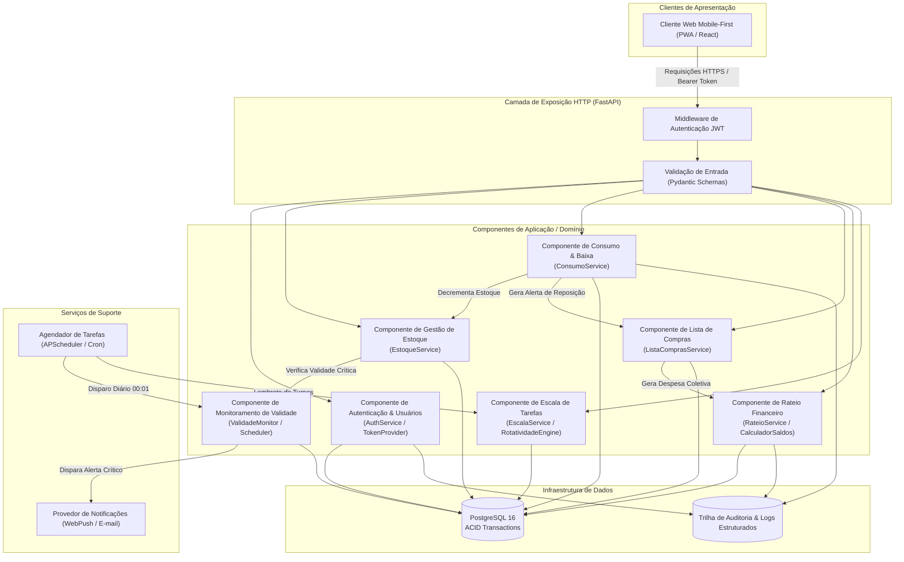
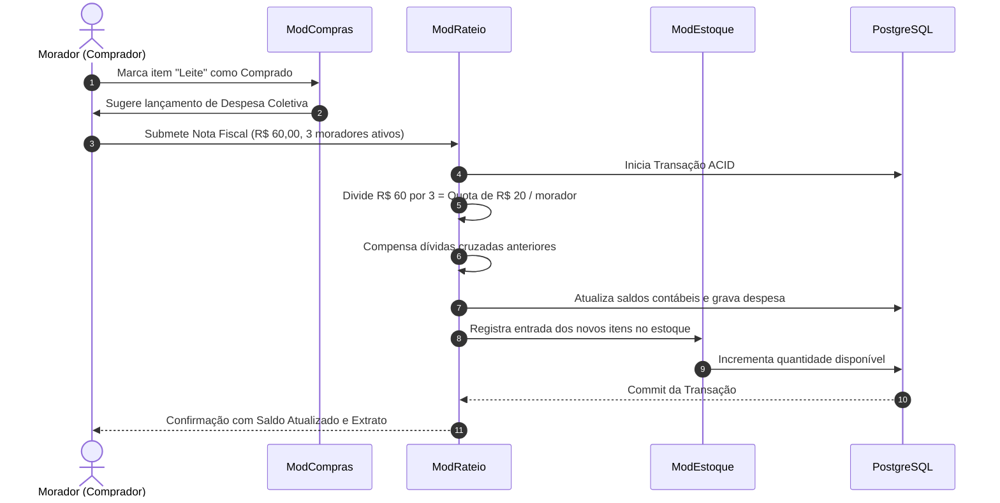
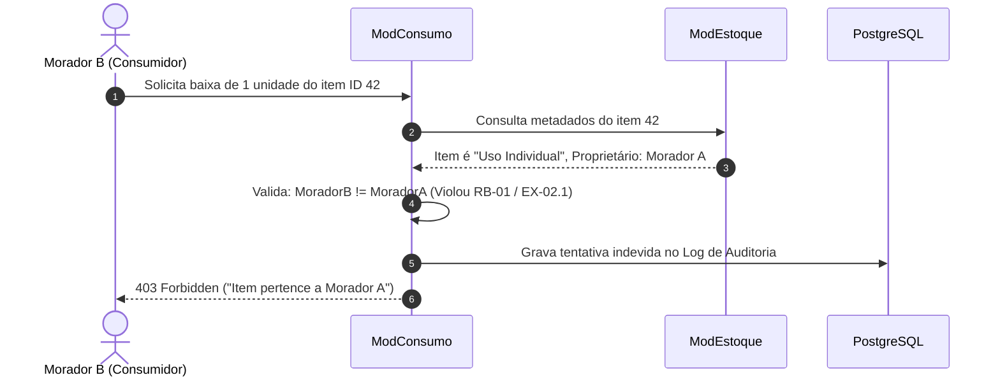

# Arquitetura do Sistema: Cozinha de República (CoChef)
<!-- File: docs/arquitetura.md -->
<!-- Mantido por: Tech Lead + Equipe de Arquitetura -->
<!-- Status: Ativo / Em conformidade com constitution.md -->

Este documento estabelece a visão arquitetural, o modelo de componentes, os padrões estruturais e a fundamentação técnica do sistema **Cozinha de República (CoChef)**, em estrita observância aos princípios da [Constituição do Projeto](../constitution.md) e às especificações em [docs/specs/specs.md](./specs/specs.md).

---

## 1. Visão Geral e Estilo Arquitetural

O CoChef adota o padrão de **Arquitetura em Camadas com Separação de Domínio (Clean / Layered Architecture)** com comunicação síncrona via API RESTful e eventos assíncronos para rotinas temporais (crons de validade e tarefas).

```
+-------------------------------------------------------------------+
|                        Camada de Apresentação                     |
|           (SPA Mobile-First / PWA - React + TailwindCSS)          |
+-------------------------------------------------------------------+
                                  |
                                  | HTTPS / JSON (REST + JWT)
                                  v
+-------------------------------------------------------------------+
|                       Camada de API / Controladores               |
|            (FastAPI Routers + Validação Pydantic + Middlewares)   |
+-------------------------------------------------------------------+
                                  |
                                  v
+-------------------------------------------------------------------+
|                     Camada de Aplicação / Casos de Uso            |
|       (EstoqueService, ConsumoService, RateioService, etc.)        |
+-------------------------------------------------------------------+
                                  |
                                  v
+-------------------------------------------------------------------+
|                     Camada de Domínio / Regras de Negócio         |
|         (Entidades, Políticas de Rateio, Invariantes EARS)        |
+-------------------------------------------------------------------+
                                  |
                                  v
+-------------------------------------------------------------------+
|                    Camada de Infraestrutura e Persistência        |
|        (SQLAlchemy ORM + PostgreSQL 16 + Alembic Migrations)      |
+-------------------------------------------------------------------+
```

### Justificativa do Estilo:
* **Independência de Frameworks:** As regras de negócio centrais (divisão igualitária de despesas, compensação implícita de saldos, controle de propriedade individual) residem puramente no domínio, sem dependência direta do banco de dados ou da camada HTTP.
* **Testabilidade Binária (SDD):** Facilita a escrita de testes unitários isolados para cada cláusula EARS (WHEN, WHILE, IF/THEN) sem exigir subida de servidores ou infraestrutura externa.
* **Manutenibilidade e Evolução:** Permite substituir ou atualizar componentes de infraestrutura (ex: drivers de banco ou canais de notificação) sem impactar as regras da cozinha da república.

---

## 2. Diagrama de Componentes do Sistema (C4 Container / Component)

O diagrama abaixo descreve a interligação de alto nível entre os clientes, a camada de controle, os serviços funcionais do domínio e os subsistemas de dados e mensageria:



---

## 3. Descrição Detalhada dos Componentes

### 3.1. Componente de Autenticação e Gestão de Moradores (`ModAuth`)
* **Responsabilidade:** Gerenciar o ciclo de vida dos usuários, cadastro de repúblicas, verificação de credenciais e controle de sessão stateless via JWT.
* **Interfaces Principais:**
  * `POST /auth/register`: Registro com validação de unicidade de e-mail e hashing `bcrypt`.
  * `POST /auth/login`: Autenticação e emissão de token JWT com tempo de vida de 24 horas.
  * `GET /auth/me`: Dados do morador autenticado e permissões (RBAC).
* **Rastreabilidade EARS:** Cobre `docs/specs/07_autenticacao_moradores.md`.

### 3.2. Componente de Gestão de Estoque (`ModEstoque`)
* **Responsabilidade:** Catalogar mantimentos, classificar em *Uso Coletivo* vs *Uso Individual*, registrar compartimento físico e estoque mínimo de segurança.
* **Interfaces Principais:**
  * `GET /estoque`: Listagem com filtros por categoria, localização e status.
  * `POST /estoque`: Cadastro de novo item com validação de validade futura.
  * `PUT /estoque/{id}`: Atualização cadastral autorizada.
* **Rastreabilidade EARS:** Cobre `docs/specs/01_gestao_estoque.md`.

### 3.3. Componente de Consumo e Baixa (`ModConsumo`)
* **Responsabilidade:** Controlar saídas de estoque de forma atômica, salvaguardar itens individuais contra consumo alheio e registrar trilha de auditoria imutável.
* **Interfaces Principais:**
  * `POST /consumo/baixa`: Decremento de saldo, verificação de propriedade e gravação de histórico.
  * `GET /consumo/historico`: Consulta ao registro de movimentações dos últimos 30 dias.
* **Rastreabilidade EARS:** Cobre `docs/specs/02_consumo_baixa.md`.

### 3.4. Componente de Monitoramento e Validade (`ModValidade`)
* **Responsabilidade:** Computar diariamente produtos em *Validade Crítica* (≤ 3 dias), disparar notificações direcionadas e inativar produtos vencidos para descarte.
* **Interfaces Principais:**
  * `GET /validade/criticos`: Itens para exibição imediata no banner do painel.
  * `POST /validade/executar-checagem`: Rota interna disparada pelo scheduler diário.
* **Rastreabilidade EARS:** Cobre `docs/specs/03_monitoramento_validade.md`.

### 3.5. Componente de Lista de Compras (`ModCompras`)
* **Responsabilidade:** Gerenciar a lista colaborativa sincronizada, aceitar demandas manuais e auto-inserir itens quando o estoque coletivo atinge o limite mínimo.
* **Interfaces Principais:**
  * `GET /compras`: Listagem ordenada por prioridade (esgotados > críticos > manuais).
  * `POST /compras/adicionar`: Inclusão manual com deduplicação automática.
  * `PATCH /compras/{id}/status`: Marcação de item como comprado no supermercado.
* **Rastreabilidade EARS:** Cobre `docs/specs/04_lista_compras.md`.

### 3.6. Componente de Rateio Financeiro (`ModRateio`)
* **Responsabilidade:** Processar notas fiscais de despesas coletivas, dividir o montante estritamente entre moradores ativos, realizar compensação implícita de saldos e calcular a matriz de liquidação.
* **Interfaces Principais:**
  * `POST /financeiro/despesas`: Lançamento de compra coletiva com recálculo imediato.
  * `GET /financeiro/balanco`: Matriz de saldos devedores e credores ("quem deve para quem").
  * `POST /financeiro/liquidar`: Fechamento de balanço exclusivo do Administrador.
* **Rastreabilidade EARS:** Cobre `docs/specs/05_rateio_financeiro.md`.

### 3.7. Componente de Escala de Tarefas (`ModEscala`)
* **Responsabilidade:** Distribuir turnos domésticos de forma justa e balanceada, receber confirmações de tarefas e executar o protocolo consensual de troca de turnos.
* **Interfaces Principais:**
  * `GET /escalas/mes`: Calendário completo de turnos e responsáveis.
  * `POST /escalas/{id}/concluir`: Check-in de execução da tarefa do turno.
  * `POST /escalas/troca`: Solicitação de substituição bilateral entre moradores.
  * `PATCH /escalas/troca/{id}/responder`: Aceite ou rejeição formal pelo par solicitado.
* **Rastreabilidade EARS:** Cobre `docs/specs/06_escala_tarefas.md`.

---

## 4. Escolhas Tecnológicas e Justificativas Técnicas

| Camada | Tecnologia Selecionada | Versão / Padrão | Justificativa Técnica Alinhada ao Projeto |
| :--- | :--- | :--- | :--- |
| **Backend Framework** | **Python / FastAPI** | Python 3.13 / FastAPI 0.115+ | Tipagem estática nativa (type hints), validação robusta em tempo de compilação/execução com Pydantic v2, documentação OpenAPI automática e suporte a concorrência assíncrona com alto rendimento. |
| **Persistência / SGBD** | **PostgreSQL** | PostgreSQL 16 | Confiabilidade transacional estrita (ACID), suporte a tipos monetários precisos (`NUMERIC`), controle de concorrência com locks e integridade referencial mandatória para o rateio contábil. |
| **ORM / Migrations** | **SQLAlchemy + Alembic** | SQLAlchemy 2.0+ / Alembic 1.13+ | Padrão Data Mapper/Active Record moderno com suporte async, isolamento de consultas com prevenção nativa a SQL Injection e histórico versionado de migrações no repositório Git. |
| **Frontend / Mobile** | **React + Vite + TailwindCSS** | React 18+ / Vite / Tailwind | Arquitetura SPA responsiva mobile-first com suporte a PWA (Progressive Web App), oferecendo renderização fluida em dispositivos a partir de 360px sem overhead de app nativo. |
| **Autenticação** | **JWT (PyJWT) + Passlib (bcrypt)** | JWT (HS256) / bcrypt (cost 12) | Autenticação stateless de alta performance, sem dependência de sessão centralizada em memória, com hash computacionalmente resistente a força bruta. |
| **Scheduler Assíncrono** | **APScheduler** | APScheduler 3.10+ | Execução determinística de rotinas em background no mesmo ambiente de runtime para checagem de validades às 00:01 e lembretes de turnos. |
| **Suíte de Testes** | **Pytest** | Pytest 8.0+ | Padrão consolidado no ecossistema Python, suporte a fixtures reutilizáveis, parametrização para testes EARS (`@pytest.mark.parametrize`) e integração perfeita ao CI. |

---

## 5. Fluxos Críticos de Dados

### 5.1. Ciclo de Compras e Rateio Contábil Integrado


### 5.2. Ciclo de Consumo com Salvaguarda de Propriedade

