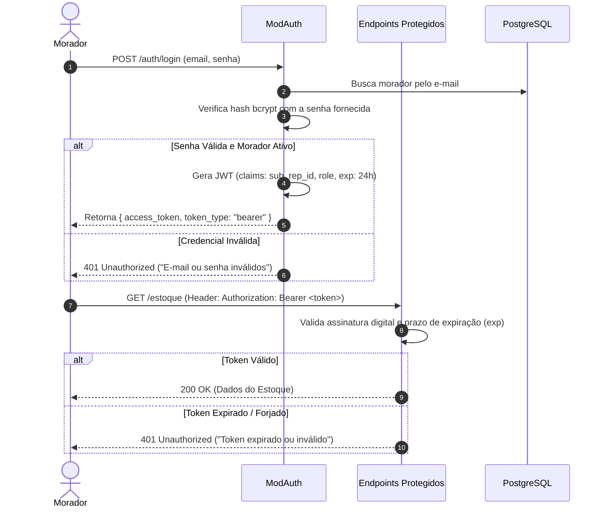

# Diretrizes e Arquitetura de Segurança: Cozinha de República (CoChef)
<!-- File: docs/seguranca.md -->
<!-- Mantido por: Tech Lead + Especialista em Segurança -->
<!-- Status: Ativo / Em conformidade com constitution.md e ISO 25010 -->

Este documento estabelece as diretrizes de segurança da informação, a modelagem de ameaças e os mecanismos de proteção para a plataforma **Cozinha de República (CoChef)**, em conformidade com as restrições da [Constituição do Projeto](../constitution.md) e as especificações de requisitos não-funcionais ([docs/specs/07_autenticacao_moradores.md](./specs/07_autenticacao_moradores.md)).

---

## 1. Princípios Fundamentais de Segurança

1. **Defesa em Profundidade (*Defense in Depth*):** A segurança não depende de uma única barreira. Aplica-se validação de dados no cliente (PWA), sanitização estrita no gateway (Pydantic), autorização no middleware da aplicação (RBAC) e restrições de integridade no banco de dados (constraints ACID).
2. **Princípio do Menor Privilégio (*Least Privilege*):** Usuários comuns (moradores) recebem estritamente as permissões necessárias para operar seu cotidiano doméstico. Ações críticas (fechamento de balanço contábil, inativação de membros, redefinição de escalas) são restritas ao perfil de Administrador.
3. **Privacidade e Proteção de Dados:** Dados sensíveis (senhas, documentos financeiros de rateio) são protegidos com criptografia moderna em repouso e em trânsito.
4. **Não-Repúdio e Auditoria Contínua:** Eventos de impacto (consumo de itens, transferências financeiras, trocas de turnos) deixam registros imutáveis de auditoria.

---

## 2. Modelagem de Ameaças (Metodologia STRIDE)

A tabela abaixo sintetiza a análise de ameaças baseada no modelo **STRIDE** adaptada à realidade do domínio de repúblicas estudantis:

| Ameaça STRIDE | Cenário de Risco no Domínio da República | Impacto no Negócio | Contramedida Arquitetural Implementada |
| :--- | :--- | :--- | :--- |
| **Spoofing** (Falsificação de Identidade) | Morador A forja requisição fingindo ser Morador B para dar baixa em itens alheios ou aprovar troca de turno sem consentimento. | Violação de confiança, conflitos interpessoais graves na moradia. | Autenticação obrigatória com **JWT assinado via HMAC-SHA256**. O identificador do usuário é extraído exclusivamente do claim `sub` do token verificado criptograficamente, ignorando IDs enviados no corpo da requisição. |
| **Tampering** (Adulteração de Dados) | Morador intercepta ou manipula requisição para alterar o valor de uma despesa coletiva de R$ 50 para R$ 500 no rateio financeiro. | Desequilíbrio contábil e prejuízo financeiro direto aos moradores. | Comunicação cifrada com **HTTPS/TLS 1.3**. Validação de esquemas e limites com Pydantic v2. Transações ACID no PostgreSQL com validação de invariantes contábeis de partidas dobradas. |
| **Repudiation** (Repúdio de Ações) | Morador consome 5 caixas de leite coletivas ou concorda com turno de limpeza de sábado e depois nega a autoria da ação. | Incerteza operacional, quebra das escalas de tarefas e atritos. | **Log de Auditoria Append-Only:** Toda ação de consumo, rateio e troca gera registro imutável com timestamp UTC, ID do usuário autenticado e metadados contextuais. |
| **Information Disclosure** (Vazamento de Informação) | Exposição pública ou vazamento de balanços financeiros, extratos bancários de notas e credenciais de login. | Quebra de privacidade dos estudantes residentes. | Senhas protegidas com algoritmo **bcrypt (fator de custo 12 + salt)**. Rotas de extrato e estoque exigem token válido. Headers de segurança HTTP (`X-Content-Type-Options`, `Content-Security-Policy`). |
| **Denial of Service** (Negação de Serviço) | Script malicioso ou requisições em loop derrubam a API no momento em que moradores precisam consultar a lista no mercado. | Indisponibilidade operacional da cozinha e perda de produtividade. | Implementação de **Rate Limiting** por IP e por Token JWT (máximo 120 req/min para rotas autenticadas e 10 req/min para `/auth/login`). Paginação obrigatória de consultas. |
| **Elevation of Privilege** (Elevação de Privilégio) | Morador comum tenta forçar chamada direta aos endpoints `/admin/fechar-balanco` ou `/admin/inativar-morador`. | Destruição do histórico contábil e desgoverno na república. | **Middleware RBAC (Role-Based Access Control):** Decorador de rota `@require_role("ADMIN")` que inspeciona o token JWT e retorna compulsoriamente código `HTTP 403 Forbidden` para moradores comuns. |

---

## 3. Arquitetura de Autenticação e Autorização

### 3.1. Hashing e Armazenamento de Senhas
* **Algoritmo Obrigatório:** `bcrypt` com salt aleatório individual de 128 bits e fator de custo (*work factor*) mínimo igual a 12.
* **Proibição Estrita:** É terminantemente vedado o armazenamento de senhas em texto puro, MD5, SHA-1 ou SHA-256 sem salt.
* **Política de Complexidade:** Senhas devem possuir no mínimo 8 caracteres, incluindo pelo menos um dígito numérico e uma letra maiúscula.

### 3.2. Ciclo de Vida do Token JWT


### 3.3. Controle de Acesso Baseado em Papéis (RBAC)
A matriz de privilégios define a fronteira operacional dos papéis:

| Ação do Sistema | Morador Comum | Administrador da República |
| :--- | :---: | :---: |
| Cadastrar / Consultar produtos no estoque | Sim | Sim |
| Dar baixa em itens de uso coletivo | Sim | Sim |
| Dar baixa em itens individuais de sua propriedade | Sim | Sim |
| Dar baixa em itens individuais de terceiros | **Bloqueado (403)** | **Bloqueado (403)** |
| Adicionar itens à lista de compras | Sim | Sim |
| Marcar itens como comprados | Sim | Sim |
| Registrar compra coletiva para rateio | Sim | Sim |
| Fechar e liquidar balanço financeiro do ciclo | **Bloqueado (403)** | Sim |
| Solicitar / Aceitar troca de escala de tarefas | Sim | Sim |
| Inativar / Cadastrar novos membros na república | **Bloqueado (403)** | Sim |

---

## 4. Sanitização de Entradas e Prevenção contra Vulnerabilidades (OWASP Top 10)

### 4.1. Prevenção de SQL Injection (A03:2021)
* O acesso aos dados é realizado estritamente por meio do **SQLAlchemy ORM** utilizando queries parametrizadas.
* É expressamente proibida a concatenação direta de strings em comandos SQL brutos.

### 4.2. Sanitização e Validação de Esquemas (Pydantic v2)
Todos os dados que adentram o sistema via HTTP são validados contra esquemas estritos com tipagem forte:
```python
# Exemplo de Validação Estrita de Input
class ItemEstoqueCreate(BaseModel):
    nome: constr(strip_whitespace=True, min_length=2, max_length=100)
    quantidade: condecimal(gt=Decimal('0.00'), max_digits=8, decimal_places=2)
    unidade_medida: Literal["unidade", "kg", "g", "litro", "ml", "pacote"]
    categoria: Literal["coletivo", "individual"]
    data_validade: date
    compartimento: constr(strip_whitespace=True, min_length=2, max_length=60)

    @field_validator("data_validade")
    def validar_validade_futura(cls, v):
        if v <= date.today():
            raise ValueError("A data de validade deve ser futura.")
        return v
```

### 4.3. Cabeçalhos de Segurança HTTP (A05:2021)
O backend injeta compulsoriamente os seguintes headers nas respostas:
* `X-Content-Type-Options: nosniff` (impede MIME-type sniffing).
* `X-Frame-Options: DENY` (previne ataques de Clickjacking).
* `Content-Security-Policy: default-src 'self'` (mitiga XSS).
* `Strict-Transport-Security: max-age=31536000; includeSubDomains` (força HTTPS).

---

## 5. Observabilidade, Auditoria e Logs Estruturados

1. **Formato JSON Padronizado:** Todos os logs de aplicação são emitidos em formato JSON estruturado com os campos:
   * `timestamp`: Data/hora UTC em padrão ISO-8601.
   * `level`: Severidade (`INFO`, `WARNING`, `ERROR`, `CRITICAL`).
   * `user_id`: Identificador do morador autenticado (ou `anonymous`).
   * `action`: Ação executada (ex: `ESTOQUE_BAIXA`, `RATEIO_LANCAMENTO`).
   * `resource_id`: Identificador da entidade afetada.
   * `status`: Resultado (`SUCCESS`, `FORBIDDEN`, `VALIDATION_ERROR`).
2. **Sanitização de Logs (Data Masking):**
   * É estritamente vedado o registro de senhas, hashes, tokens JWT completos, dados de cartões ou documentos pessoais nas mensagens de log.
3. **Auditoria de Violação de Propriedade:** Tentativas de dar baixa em itens alheios disparam logs com nível `WARNING` contendo o ID do infrator e o ID da vítima para permitir aos administradores identificar desvios de conduta na república.
